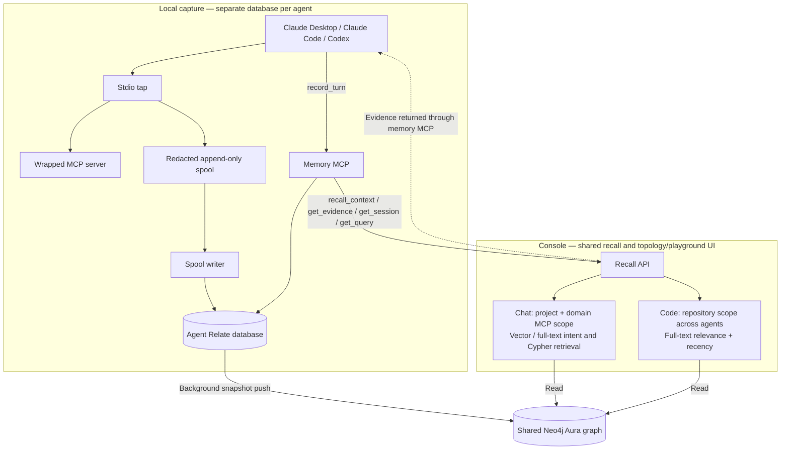
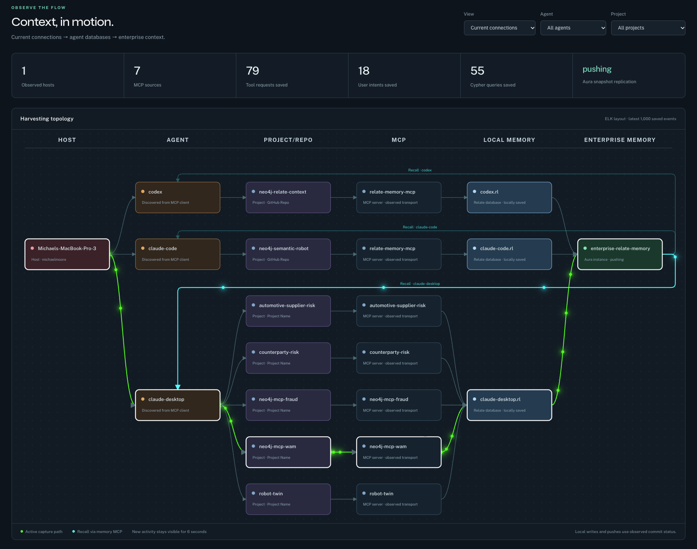
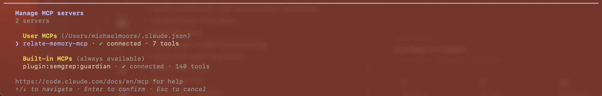
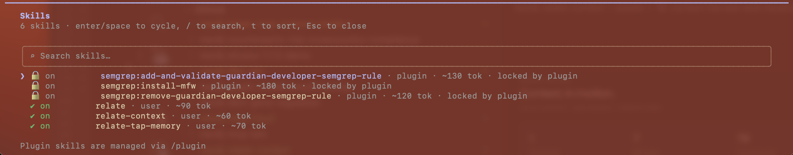
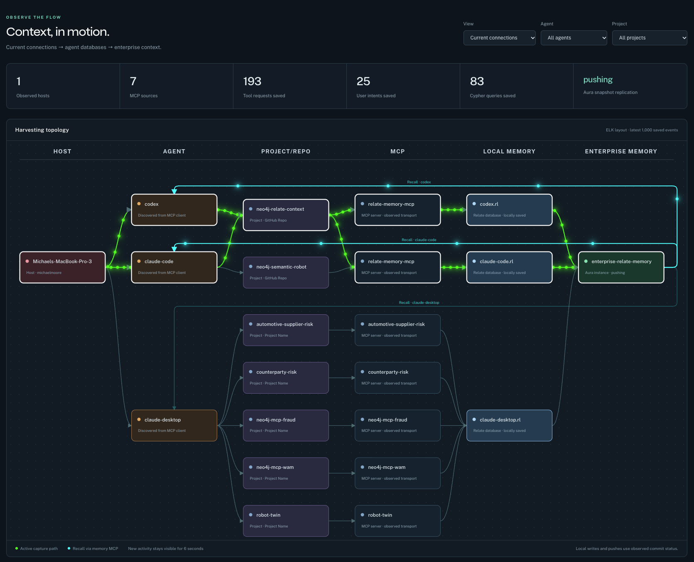

# neo4j-relate-context
A federated context engine using relate.ai with replication to Neo4j Aura.

## What it is

A design experiment for fast enterprise memory.

Implements a capture-and-recall system for coding/chat context backed by a local Relate.ai graph and a hosted Neo4j Aura graph accessible to the enterprise. A tap process wraps each MCP server, records tool calls to a local .rl database, and a native worker replicates to enterprise Aura. The relate-memory-mcp server exposes record_turn / recall_context / get_evidence / get_session / save_context / flush_memory. The POLE+O graph (ContextProject → ContextSession → ContextTurn → ContextMessage, plus ContextReasoning/ContextMemory/ContextNote) is the backbone.

## Architecture

Capture persists locally before background replication to Aura. The stdio tap
observes wrapped MCP traffic; the memory MCP records conversation turns when
called by the agent. Each agent owns a separate Relate database. The console
provides shared recall and the topology/playground UI.



The memory MCP can itself be wrapped by the tap. Chat retrieval uses Aura and
an embedding provider; Code retrieval reads existing recorded history without
embeddings. Recall reports local pending evidence separately from Aura results.

## Chat data flow

Chat context follows a project and domain MCP source. The tap captures wrapped
MCP requests and responses into the agent's local Relate database; `record_turn`
adds conversation context and reported evidence. Background snapshot pushes
replicate the local graph to enterprise Aura. For each new domain question,
`recall_context` searches saved intents within the same project and MCP source
using vector/full-text retrieval and returns complete saved Cypher, or a query
ID to fetch with `get_query`.



The highlighted Desktop route illustrates Chat capture through `neo4j-mcp-wam`
into `claude-desktop.rl` and onward to enterprise memory. Green marks capture
activity; cyan marks recall returning through the memory MCP. The screenshot's
`pushing` status indicates replication in progress, not confirmed delivery.

## Claude Desktop installation

Claude Desktop uses `services/relate-memory_mcp.py` over MCP stdio. Each
connection serializes local operations on `~/.relate-tap/databases/claude-desktop.rl`;
Aura pushes are serialized separately. Saved notes and captured exchanges
record the OS account name as `username` with `identity_source: os`.

The Claude skill is in `skills/relate-chat-memory/SKILL.md`. Upload that file
or a ZIP containing its folder through Customize → Skills → Add skill →
Upload skill, and leave it enabled. It organizes coding context by repository,
other project context by Claude project name, and general context using POLE-O
entities.

In Claude's global Instructions for Claude, add this routing instruction once:

> When the relate-memory-mcp connector is available, use my enabled
> relate-chat-memory skill in every conversation to recall and record context
> automatically, following its project scoping, privacy, and retry rules. No
> separate request to save memory is needed; honor any request to pause or
> exclude capture.

The skill guides model tool calls; it is not a guaranteed transcript hook.
Start a new chat after installation or a skill update to load the latest
instructions. For each substantive domain-data question, recall searches with
the current question and returns complete stored queries within its budget;
`retrieval_required: true` means fetch `get_query` before reuse. A successful
`record_turn` confirms local capture; `flush_memory` queues background
replication. Verify an exact record in Aura before claiming remote delivery.

## Claude Desktop memory permissions

In **Settings → Plugins → relate-memory-mcp → Permissions**, configure the
memory tools as follows. Some Claude versions list connectors under
**Customize → Connectors** instead.


| Tool | Permission | Purpose |
| --- | --- | --- |
| `record_turn` | **Always allow** | Automatic conversation capture. |
| `flush_memory` | **Always allow** | Request background replication to Aura. |
| `recall_context` | **Always allow** | Uninterrupted context recall. |
| `get_query` | **Always allow** | Retrieve complete saved Cypher and parameters. |
| `get_evidence` | **Always allow** | Retrieve original questions supporting an intent. |
| `get_session` | **Always allow** | Read captured session messages. |

The first two settings enable automatic capture and replication requests; the
remaining settings enable uninterrupted recall. `save_context` can remain
**Needs approval** for explicitly requested standalone notes. Set it to
**Always allow** too if those requested saves should run without approval.

In **Auto** mode, tools set to **Needs approval** are subject to Claude's
automated safety check. That check can block a memory write as possible
sensitive-information sharing before the MCP server receives it. The tool
activity may show **“Didn't run”**, even though the server is connected and
can read/write its database. Setting a trusted tool to **Always allow** permits
automatic use without that check; captured exchanges are stored locally and
replicated to the configured Aura destination.

These are Claude application permissions, separate from the MCP launch entry
in `claude_desktop_config.json`, filesystem permissions, and Aura credentials.
No changes to those connection settings are needed for this approval issue.
After configuring permissions, test a new turn and inspect the actual
`record_turn` result to confirm that it saved successfully. A queued
`flush_memory` request still does not prove delivery to Aura.

See [Claude's connector permission behavior](https://support.claude.com/en/articles/13345190-get-started-with-claude-cowork).

## Captured context

Captured tool-call messages link through `USES_TOOL` to project-scoped
`ContextTool` catalog nodes. Each visible query execution has its own
`ContextQuery`, reached through `EXECUTES_QUERY`, containing Cypher, parameters,
and any supplied rationale and observed result summary.

Each turn links through `HAS_REASONING` to a `ContextReasoning` node with a
concise evidence-backed summary. Its `SUPPORTED_BY` links reference captured
tool calls and the final response. Optional telemetry includes `model`,
`model_version`, `model_effort`, `input_tokens`, `output_tokens`, `total_tokens`,
and `elapsed_ms`. The service sums input and output tokens when both are known,
and rejects an inconsistent supplied total. Model, usage, and timing provenance
are `client_reported` or `unavailable`; unknown values are absent, never zero
estimates. The MCP service cannot independently measure the entire model turn
or retrieve Claude's private usage telemetry. A UI label such as "Opus 5.5"
with "Medium" effort does not establish an exact backend model version.

To materialize tool/query nodes from existing captured messages, run
`python3 backfill_tool_context.py --database relate-dbs/claude-desktop.rl`.
This additive, idempotent backfill leaves historical model/usage/timing unknown
and does not invent historical reasoning summaries. All three new labels are
included in Aura replication.

Run the graph integration tests with `python3 -B -m unittest discover -s tests -v`.

## Relate tap console

The console provides a Docker-hosted live topology and Relate playground, plus a
transparent MCP command wrapper:

```sh
relate-tap --name neo4j-fraud -- node server.js
```

See [setup, source selection, Aura replication and capture semantics](docs/relate-tap.md).

On this Mac, `/usr/local/bin/relate-tap` is a symlink to the user-owned
`~/.local/share/uv/tools/relate-tap/bin/relate-tap` installation, alongside
`/usr/local/bin/neo4j-mcp`. This is a `uv` installation, not a Homebrew package.
Create the link once with administrator access:

```sh
sudo ln -s "$HOME/.local/share/uv/tools/relate-tap/bin/relate-tap" /usr/local/bin/relate-tap
```

Subsequent builds update the user-owned installation behind that link; they
do not require administrator access or changes to the MCP executable path.
From this repository, reinstall the current build with:

```sh
UV_TOOL_BIN_DIR="$HOME/.local/bin" uv tool install --reinstall .
```

The `/usr/local/bin/relate-tap` link continues to point to the updated tool.
Use that path in MCP configurations, or `relate-tap` when `/usr/local/bin`
is on the client's `PATH`.

The first MCP connection discovers its agent, opens or creates `<agent>.rl`,
installs the memory skill for Claude Code or Codex if missing, and registers
its route with the console. Claude Desktop uses its memory MCP connector.
The topology separates current connections from capture history and shows
the per-agent database followed by the enterprise Aura destination.

## Claude Code installation across repositories

Register the memory MCP once at **user scope**, using the installed executable
path described above:

```sh
claude mcp add --scope user relate-memory-mcp -- \
  /usr/local/bin/relate-tap --name relate-memory-mcp -- \
  /usr/local/bin/relate-tap memory-server --agent claude-code
```

This makes the connection available across repositories without adding an MCP
entry to each repository. Do not supply a fixed `--project`. Start Claude Code
from the repository you want to work in:

```sh
cd ~/GitHub/your-repo
claude
```

The tap and memory server discover a canonical project key from the Git origin,
such as `git:github.com/graphadvantage/neo4j-relate-context`. SSH and HTTPS origins
for the same host and repository share a key; different owners or hosts remain
separate. Renamed checkouts and worktrees retain the same project attribution.
All Claude Code repositories write to `~/.relate-tap/databases/claude-code.rl`,
organized under their respective `ContextProject` nodes. Git-attributed projects
and sessions receive the secondary `Code` label. The native worker pushes this
database to the configured enterprise Aura instance.

Repositories without a usable origin use a `git-local:` hash of the host name
and Git common directory. This keeps worktrees together without publishing local paths. Local
keys are specific to that checkout and machine. Explicit `--project` overrides
remain exact user-selected scopes. Existing short-name history is retained and
never silently included in canonical recall; see
[binding verified legacy sessions](docs/relate-tap.md#repository-identity-and-legacy-history).

Automatic conversation capture also requires memory instructions. Add the
following to `~/.claude/CLAUDE.md` to enable it across repositories:

> When relate-memory-mcp is connected, use the relate-tap-memory skill to recall
> repository context at session start and call record_turn after each completed
> exchange. Keep one session ID per chat and stable turn IDs for retries. Use the
> discovered Git-origin project default, report capture failures, and honor any
> request to pause or exclude capture. Keep live Git authoritative and save
> standalone project notes only when requested.

The first tap connection installs `relate-tap-memory` if it is missing and
preserves an existing installation. The skill supplies the capture workflow.
MCP registration alone does not record every chat turn or local coding tool
call; the tap records calls passing through it, and `record_turn` supplies
conversation context and observed coding evidence.

Restart an existing Claude Code session after changing MCP configuration or user
instructions. Run `/mcp` and confirm `relate-memory-mcp` is connected. If a route
is missing or attributed to another repository, check for a project/local entry
with the same server name overriding the user registration, or a fixed
`--project` argument. Capture failures should be reported; a queued flush is
not confirmation of delivery to Aura.

The `/mcp` view should show `relate-memory-mcp` under **User MCPs**, connected
with seven tools. User scope makes the connection available across repositories.



Open `/skills` and confirm `relate-tap-memory` is listed as a user skill and
enabled. The screenshot also shows `relate` and `relate-context`; those are
separate skills, and the active MCP capture workflow uses `relate-tap-memory`.
If the newly installed skill is absent, restart Claude Code and check again.
The Claude Desktop permissions screenshot above applies to Desktop setup;
Claude Code connection and skill validation use these two views.



## Code Cowork data flow

Codex and Claude Code capture repository work into separate local databases,
`codex.rl` and `claude-code.rl`, then replicate to the same enterprise Aura
graph. Shared recall is scoped to the repository's `Code` projects and sessions,
with optional filtering by authoring agent. It retrieves recorded turns,
decisions and session evidence using full-text relevance and recency, without
requiring a domain MCP identifier, saved Cypher or embeddings.



The highlighted routes show both coding agents working on
`neo4j-relate-context`, retaining separate capture paths while sharing the
repository through Aura. Cyan return paths illustrate recall by either agent.
This topology shows routing and activity; recalled claims still need checking
against the current working tree and Git history.

Coding recall is shared across agents through Aura. For example:

```json
{"context_kind": "Code", "query": "significant design decisions", "source_agent": "codex"}
```

Pass this to `recall_context`; omit `project` to accept the Git-origin default.
Omit `source_agent` to recall all agents' work. Matching Git provenance or a
stored Code-only project defaults to Code recall even without a query, regardless
of agent name. Use explicit `context_kind` for mixed or unknown projects. No
domain MCP name or saved Cypher is required.
Results include recent sessions, matching recorded turns and structured memories,
with author/session/turn provenance. Use `get_evidence` with `turn_id` or
`get_session` with the returned `session_key`/session `id`, both with
`context_kind: "Code"`, to expand evidence. Session reads support backward paging
with `before_position`. Existing captured Code sessions work immediately; no
re-embedding or summary migration is needed.

Coding retrieval uses an Aura full-text index and recency, without semantic
vectors. The console incrementally indexes existing and new recorded turns;
responses report `fulltext_recency` when the index is ready, or
`lexical_recency` for a scoped substring fallback while it builds or is
unavailable. Index failures are reported as degraded, and pending local evidence
uses the read-only fallback. Index maintenance does not require an OpenAI key.
Recalled statements still require checking against live Git. Empty topic matches
do not mean no sessions exist; inspect `sessions`, response state and
`pending_local`. Chatbot intent/Cypher recall retains its separate MCP-scoped
vector/full-text path.

New Code turns record full Git commit, branch, working-tree modification state
and provenance when observed. Server observation is limited to the matching
repository; historical unknowns remain unknown. Dirty-state and freshness
annotations describe the evidence, without asserting it is current.

Memories retain their original evidence when resolved, reopened or superseded.
`record_turn` returns `memory_ids`; a new memory can explicitly resolve or
replace an existing one using `resolves` or `supersedes`, while `memory_events`
records standalone lifecycle changes. Recall derives status from append-only
events and ranks active memories ahead of resolved or superseded history. See
[freshness and supersession](docs/freshness-and-supersession.md) for the schema,
scope checks and replication behavior.

The console's **Cowork recall hits** counter, beside **Cypher queries saved**,
counts Code recall requests that return repository evidence recorded by another
agent. Each receipt counts once, including usable pending local evidence; empty
results, same-agent evidence and session inventories do not count. Totals persist
in the console's capture graph across restarts and respect the requesting-agent
and project filters. Tracking starts when this metric is enabled; previous
unrecorded recall activity is not backfilled. A hit measures retrieval, not reuse.

## Aura embedding smoke test

Set `OPENAI_API_KEY` alongside the `AURA_*` connection values in the ignored
`.env` file, then run:

```sh
docker compose run --rm --no-deps -T --entrypoint python3 console - < tests/smoke_aura_embeddings.py
```

This manual test calls `ai.text.embedBatch()` with two synthetic questions
using `text-embedding-3-large` and 3,072 dimensions. It creates or updates two
`ContextEmbeddingTest` nodes with IDs `ai-text-embed-batch-3072:0` and
`ai-text-embed-batch-3072:1`. Their `embedding` properties are native
`VECTOR<FLOAT32>(3072)` values, assigned directly from the Cypher 25
procedure result.
It verifies the committed property types and dimensions and prints metadata only.
The test makes a paid OpenAI request and is excluded from automatic unit tests.
It does not process existing chat messages or create retrieval indexes.

## Chat and Code classification

Captured projects and sessions carry secondary `Chat` or `Code` labels:
chatbot/MCP project context is `Chat`, and Git-attributed repository work is
`Code`. Classification is independent of which coding agent captured it.
See [Chat and Code classification](docs/relate-tap.md#chat-and-code-classification)
for automatic discovery, explicit attribution, and existing-data labeling.
