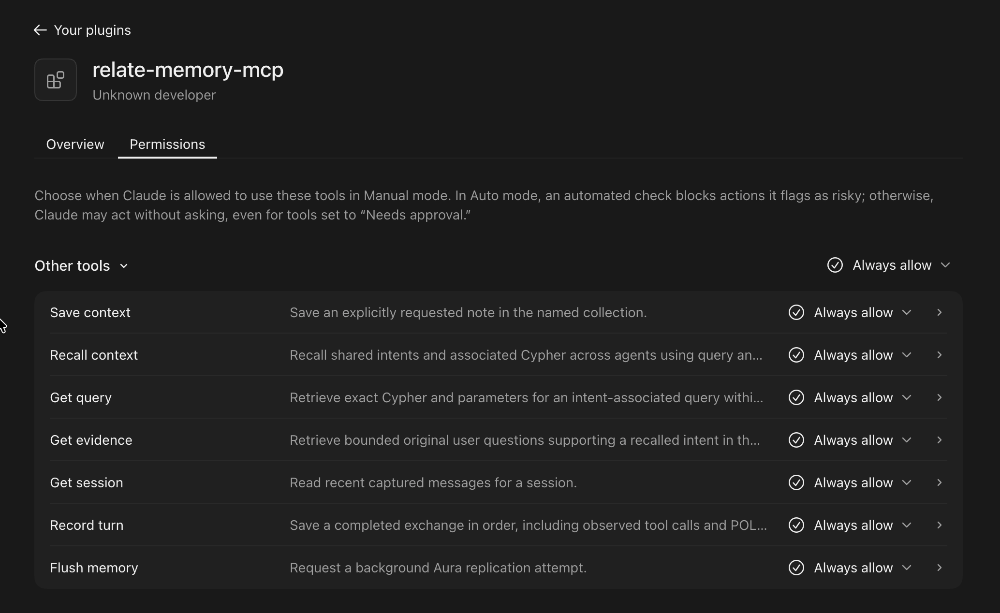

# neo4j-relate-context
A federated context engine using relate.ai with replication to Neo4j Aura

Claude Desktop uses `services/relate-memory_mcp.py` over MCP stdio. Each
connection serializes local operations on `~/.relate-tap/databases/claude-desktop.rl`;
Aura pushes are serialized separately. Saved notes and captured exchanges
record the OS account name as `username` with `identity_source: os`.

The Claude skill is in `skills/relate-chat-memory/SKILL.md`. Upload that file
or a ZIP containing its folder through Customize → Skills → Add skill →
Upload skill, and leave it enabled. It organizes coding context by repository,
other project context by Claude project name, and general context using POLE-O
entities.

In Claude's global Instructions for Claude, add this routing instruction once:

> When the relate-memory-mcp connector is available, use my enabled
> relate-chat-memory skill in every conversation to recall and record context
> automatically, following its project scoping, privacy, and retry rules. No
> separate request to save memory is needed; honor any request to pause or
> exclude capture.

The skill guides model tool calls; it is not a guaranteed transcript hook.
Start a new chat after installation or a skill update to load the latest
instructions. For each substantive domain-data question, recall searches with
the current question and returns complete stored queries within its budget;
`retrieval_required: true` means fetch `get_query` before reuse. A successful
`record_turn` confirms local capture; `flush_memory` queues background
replication. Verify an exact record in Aura before claiming remote delivery.

## Claude Desktop memory permissions

In **Settings → Plugins → relate-memory-mcp → Permissions**, configure the
memory tools as follows. Some Claude versions list connectors under
**Customize → Connectors** instead.



| Tool | Permission | Purpose |
| --- | --- | --- |
| `record_turn` | **Always allow** | Automatic conversation capture. |
| `flush_memory` | **Always allow** | Request background replication to Aura. |
| `recall_context` | **Always allow** | Uninterrupted context recall. |
| `get_query` | **Always allow** | Retrieve complete saved Cypher and parameters. |
| `get_evidence` | **Always allow** | Retrieve original questions supporting an intent. |
| `get_session` | **Always allow** | Read captured session messages. |

The first two settings enable automatic capture and replication requests; the
remaining settings enable uninterrupted recall. `save_context` can remain
**Needs approval** for explicitly requested standalone notes. Set it to
**Always allow** too if those requested saves should run without approval.

In **Auto** mode, tools set to **Needs approval** are subject to Claude's
automated safety check. That check can block a memory write as possible
sensitive-information sharing before the MCP server receives it. The tool
activity may show **“Didn't run”**, even though the server is connected and
can read/write its database. Setting a trusted tool to **Always allow** permits
automatic use without that check; captured exchanges are stored locally and
replicated to the configured Aura destination.

These are Claude application permissions, separate from the MCP launch entry
in `claude_desktop_config.json`, filesystem permissions, and Aura credentials.
No changes to those connection settings are needed for this approval issue.
After configuring permissions, test a new turn and inspect the actual
`record_turn` result to confirm that it saved successfully. A queued
`flush_memory` request still does not prove delivery to Aura.

See [Claude's connector permission behavior](https://support.claude.com/en/articles/13345190-get-started-with-claude-cowork).

## Captured context

Captured tool-call messages link through `USES_TOOL` to project-scoped
`ContextTool` catalog nodes. Each visible query execution has its own
`ContextQuery`, reached through `EXECUTES_QUERY`, containing Cypher, parameters,
and any supplied rationale and observed result summary.

Each turn links through `HAS_REASONING` to a `ContextReasoning` node with a
concise evidence-backed summary. Its `SUPPORTED_BY` links reference captured
tool calls and the final response. Optional telemetry includes `model`,
`model_version`, `model_effort`, `input_tokens`, `output_tokens`, `total_tokens`,
and `elapsed_ms`. The service sums input and output tokens when both are known,
and rejects an inconsistent supplied total. Model, usage, and timing provenance
are `client_reported` or `unavailable`; unknown values are absent, never zero
estimates. The MCP service cannot independently measure the entire model turn
or retrieve Claude's private usage telemetry. A UI label such as "Opus 5.5"
with "Medium" effort does not establish an exact backend model version.

To materialize tool/query nodes from existing captured messages, run
`python3 backfill_tool_context.py --database relate-dbs/claude-desktop.rl`.
This additive, idempotent backfill leaves historical model/usage/timing unknown
and does not invent historical reasoning summaries. All three new labels are
included in Aura replication.

Run the graph integration tests with `python3 -B -m unittest discover -s tests -v`.
# Relate tap console

The `codex/relate-tap-console` branch adds a Docker-hosted live topology and
Relate playground, plus a transparent MCP command wrapper:

```sh
relate-tap --name neo4j-fraud -- node server.js
```

See [setup, source selection, Aura replication and capture semantics](docs/relate-tap.md).

On this Mac, `/usr/local/bin/relate-tap` is a symlink to the user-owned
`~/.local/share/uv/tools/relate-tap/bin/relate-tap` installation, alongside
`/usr/local/bin/neo4j-mcp`. This is a `uv` installation, not a Homebrew package.
Create the link once with administrator access:

```sh
sudo ln -s "$HOME/.local/share/uv/tools/relate-tap/bin/relate-tap" /usr/local/bin/relate-tap
```

Subsequent builds update the user-owned installation behind that link; they
do not require administrator access or changes to the MCP executable path.
From this repository, reinstall the current build with:

```sh
UV_TOOL_BIN_DIR="$HOME/.local/bin" uv tool install --reinstall .
```

The `/usr/local/bin/relate-tap` link continues to point to the updated tool.
Use that path in MCP configurations, or `relate-tap` when `/usr/local/bin`
is on the client's `PATH`.

The first MCP connection discovers its agent, opens or creates `<agent>.rl`,
installs the memory skill for Claude Code or Codex if missing, and registers
its route with the console. Claude Desktop uses its memory MCP connector.
The topology separates current connections from capture history and shows
the per-agent database followed by the enterprise Aura destination.

## Aura embedding smoke test

Set `OPENAI_API_KEY` alongside the `AURA_*` connection values in the ignored
`.env` file, then run:

```sh
docker compose run --rm --no-deps -T --entrypoint python3 console - < tests/smoke_aura_embeddings.py
```

This manual test calls `ai.text.embedBatch()` with two synthetic questions
using `text-embedding-3-large` and 3,072 dimensions. It creates or updates two
`ContextEmbeddingTest` nodes with IDs `ai-text-embed-batch-3072:0` and
`ai-text-embed-batch-3072:1`. Their `embedding` properties are native
`VECTOR<FLOAT32>(3072)` values, assigned directly from the Cypher 25
procedure result.
It verifies the committed property types and dimensions and prints metadata only.
The test makes a paid OpenAI request and is excluded from automatic unit tests.
It does not process existing chat messages or create retrieval indexes.
